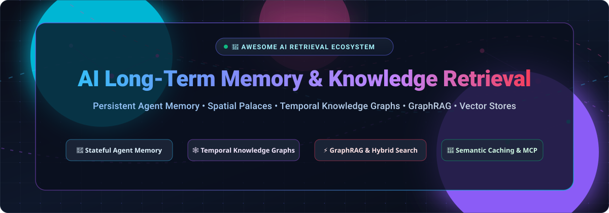

# 🧠 Awesome AI Long-Term Memory & Knowledge Retrieval

  
  
  
  
  
  
  

  

## 🌟 Top AI Long-Term Memory & Knowledge Retrieval Ecosystem

> **A comprehensive, SEO-optimized, community-curated directory of production SaaS platforms, AI memory engines, spatial memory architectures, GraphRAG frameworks, temporal knowledge graphs, and open-source retrieval systems for autonomous agents and LLMs.**

*Keywords: AI Long-Term Memory, Autonomous Agent Memory, GraphRAG, Knowledge Retrieval, Temporal Knowledge Graphs, Spatial Memory Palaces, Vector Databases, Semantic Caching, Letta, Mem0, Zep, Pinecone, Qdrant, Chroma, LangChain, MCP Memory Server.*

---

### 📖 Introduction

As Large Language Models (LLMs) and autonomous agent swarms evolve from stateless prompt responders into long-running, autonomous co-workers, **persistent long-term memory and hybrid knowledge retrieval** have become critical architecture requirements. 

This repository serves as an authoritative, continuously updated index tracking:
- 🧠 **Persistent Agent Memory Layers**: Cross-session state persistence, episodic recall, semantic user profiling, and procedural habit extraction.
- 🏛️ **Spatial & Palace Memory Architectures**: Method-of-Loci inspired spatial memory graphs for deterministic, high-fidelity agent recall.
- 🕸️ **Temporal Knowledge Graphs & GraphRAG**: Hierarchical entity linking, temporal relationship evolution, and community summary synthesis for multi-hop reasoning.
- ⚡ **High-Speed Vector Stores & In-Memory Semantic Caches**: Low-latency embedding retrieval, hybrid BM25 + dense vector indexing, and LLM cache layers.
- 🔌 **Local-First & MCP Servers**: Model Context Protocol servers enabling privacy-first, edge-native structured memory for IDEs and autonomous assistants.

---

## 📑 Table of Contents

- [📊 Sector Overview & Market Dynamics](#-sector-overview--market-dynamics)
- [☁️ SaaS / Hosted Platforms](#️-saas--hosted-platforms)
- [🔓 Open-Source GitHub Projects](#-open-source-github-projects)
- [📈 Star History](#-star-history)
- [💖 Support & Sponsorship](#-support--sponsorship)
- [🤝 How to Contribute](#-how-to-contribute)
- [📜 Disclaimer](#-disclaimer)

---

## 📊 Sector Overview & Market Dynamics

The AI long-term memory, vector database, and retrieval infrastructure market is valued at **$3.1B–$3.6B in 2026** and projected to exceed **$8.0B+ by 2030** (~23–27% CAGR), catalyzed by the explosive adoption of stateful multi-agent systems. The sector is **moderately fragmented** between innovative memory-graph specialists and purpose-built vector stores, but is steadily consolidating around major cloud database incumbents and core developer frameworks.

---

## ☁️ SaaS / Hosted Platforms

| 🏢 Platform | 💰 Company Scale (Valuation / Revenue) | 🏷️ Starting Paid Pricing | 🎁 Free Tier Limits | 📝 Description |
| :--- | :--- | :--- | :--- | :--- |
| **[LangMem / LangGraph Cloud (LangChain)](https://langchain.com)** | **$3.0B valuation** ($460M total funding) | **$39 / seat / month** (Plus Plan) | **5,000 base traces/month**, 1 user seat, 14-day retention, 1 developer LangGraph deployment | Managed persistence and long-term semantic, episodic, and procedural memory infrastructure integrated natively with LangGraph state checkpoints. |
| **[Redis Cloud & Redis LangCache](https://redis.io)** | **$2.0B valuation** (> $300M ARR) | **$5.00 / month** ($0.007/hr, Essentials Plan) | **30 MB RAM storage**, 30 concurrent connections, 5 GB monthly bandwidth, 100 ops/sec max throughput | Managed in-memory data store and semantic caching service engineered for ultra-low-latency short-term agent state, session checkpoints, and LLM response caching. |
| **[Pinecone](https://pinecone.io)** | **$750M valuation** ($138M total funding) | **$50.00 / month** minimum commitment (Standard Plan) | **2 GB storage** (~300k vectors @ 1536d), 1M read units/mo, 2M write units/mo, 5 serverless indexes, 1 GB egress/mo | Fully managed serverless vector database widely used as a high-throughput semantic long-term memory and knowledge retrieval store for production AI agents. |
| **[Weaviate Cloud](https://weaviate.io)** | **$200M valuation** ($67.7M total funding) | **$45.00 / month** (Flex Serverless Plan) | **100,000 objects**, 1 GB RAM / 10 GB disk, 1 collection (up to 3 tenants) | Managed AI-native vector database offering hybrid keyword/semantic search, generative feedback loops, and multi-tenancy for agent memory persistence. |
| **[Qdrant Cloud](https://qdrant.tech)** | **~$113M estimated valuation** ($37.8M total funding) | **$25.00 / month** (Standard 1GB Dedicated Cluster) | **4 GB disk storage**, 1 GB RAM, 0.5 vCPU (~1M vectors @ 768d, single-node cluster) | Managed high-performance vector search and semantic caching cloud built in Rust for multi-tenant agent memory, hybrid search, and context retrieval. |
| **[Letta Platform (Letta Cloud)](https://letta.com)** | **$70M valuation** ($10M total funding) | **$20.00 / month** (Pro Plan; includes $20 usage credits) | **3 stateful agents** (BYOK for LLM inference calls) | Managed stateful agent runtime built around MemGPT principles for self-editing hierarchical memory, perpetual learning, and long-running context persistence. |
| **[Mem0 Platform](https://mem0.ai)** | **$24.5M total funding** (Series A stage) | **$19.00 / month** (Starter Tier / base overage threshold) | **10,000 adds & 1,000 retrievals/mo** (first 30 days managed); **50,000 adds & 10,000 retrievals/mo** thereafter with BYOK | Managed cloud memory layer for personalized AI agents offering automatic fact extraction, multi-level user/session/agent scoping, and low-latency recall APIs. |
| **[Ragie](https://ragie.ai)** | **$5.5M total funding** (Seed stage) | **$100.00 / month** (Starter Plan) | **1,000 pages**, 1,000 retrievals, 10 GB streaming, 10 hours audio/video processing | Fully managed RAG-as-a-Service and knowledge retrieval platform providing automated document chunking, entity extraction, and hybrid search APIs for AI agents. |
| **[Graphlit](https://graphlit.com)** | **$3.56M total funding** (Seed stage) | **$49.00 / month** (Paid Plan base) | **1 GB content storage** ($0 developer credits plan) | Cloud-native multimodal knowledge-graph and RAG memory platform for ingesting, indexing, and querying conversations, documents, and media for AI agents. |
| **[Zep Cloud](https://getzep.com)** | **~$2.3M total funding** (Seed stage) | **$125.00 / month** (Flex Plan, 50,000 credits) | **10,000 credits/month** (Prototyping free tier, 1 credit ~ 350 bytes ingested) | Enterprise agent memory and context engineering platform powered by temporal knowledge graphs that continuously synthesize user interactions and business data. |

---

## 🔓 Open-Source GitHub Projects

Curated list of leading open-source repositories powering stateful AI memory, knowledge graph reasoning, and vector search, sorted by GitHub stargazers count:

- **[thedotmack/claude-mem](https://github.com/thedotmack/claude-mem)**   
  Popular persistent memory plugin and MCP server for Claude Code that captures tool-use observations, compresses them into semantic summaries, and injects relevant historical context across sessions.

- **[infiniflow/ragflow](https://github.com/infiniflow/ragflow)**   
  Open-source RAG (Retrieval-Augmented Generation) engine based on deep document understanding, multi-modal knowledge extraction, and persistent agent recall workflows.

- **[modelcontextprotocol/servers](https://github.com/modelcontextprotocol/servers)**   
  Official Model Context Protocol (MCP) collection featuring the reference knowledge-graph memory server enabling local entity, relation, and knowledge persistence for AI assistants.

- **[geekan/MetaGPT](https://github.com/geekan/MetaGPT)**   
  Multi-agent framework incorporating human workflow patterns, SOP-driven procedural memory, long-term state persistence, and cross-agent communication protocols.

- **[mem0ai/mem0](https://github.com/mem0ai/mem0)**   
  Open-source (Apache-2.0) universal memory layer for AI agents combining vector, graph, and key-value stores to dynamically extract, update, and retrieve user and session memories.

- **[MemPalace/mempalace](https://github.com/MemPalace/mempalace)**   
  Open-source structured AI memory system inspired by the classical Method of Loci ("Memory Palace"), organizing long-term agent knowledge, facts, and retrieval cues into navigable spatial hierarchies for high-recall persistence.

- **[run-llama/llama_index](https://github.com/run-llama/llama_index)**   
  Leading data framework for LLM and agent applications providing flexible data connectors, vector/graph index memory abstractions, and advanced query retrieval engines.

- **[milvus-io/milvus](https://github.com/milvus-io/milvus)**   
  Scalable open-source (Apache-2.0) distributed vector database engineered for billion-scale semantic search, hybrid retrieval, and enterprise agent knowledge-base workloads.

- **[HKUDS/LightRAG](https://github.com/HKUDS/LightRAG)**   
  Fast, lightweight open-source (MIT) graph-augmented knowledge retrieval framework offering dual-level entity/relation indexing and incremental updates at low token overhead.

- **[khoj-ai/khoj](https://github.com/khoj-ai/khoj)**   
  Self-hostable open-source (AGPL-3.0) personal AI second-brain and knowledge retrieval engine indexing Markdown, PDFs, Notion, and GitHub for grounded recall.

- **[microsoft/graphrag](https://github.com/microsoft/graphrag)**   
  Open-source (MIT) modular graph-based knowledge retrieval system from Microsoft Research that extracts entity graphs and hierarchical community summaries for multi-hop reasoning.

- **[qdrant/qdrant](https://github.com/qdrant/qdrant)**   
  Open-source (Apache-2.0) high-performance vector search engine and semantic caching backend written in Rust with rich payload filtering for long-term agent memory.

- **[topoteretes/cognee](https://github.com/topoteretes/cognee)**   
  Open-source (Apache-2.0) deterministic AI memory engine that transforms raw documents and agent conversations into interconnected graph-and-vector knowledge pipelines.

- **[getzep/graphiti](https://github.com/getzep/graphiti)**   
  Open-source (Apache-2.0) temporal knowledge-graph memory framework from Zep engineered for real-time incremental updates, bi-temporal entity tracking, and hybrid graph/vector agent recall.

- **[stanford-oval/storm](https://github.com/stanford-oval/storm)**   
  LLM-powered knowledge curation system that synthesizes multi-perspective research, dynamic topic graphs, and citations into grounded long-term knowledge articles.

- **[chroma-core/chroma](https://github.com/chroma-core/chroma)**   
  Open-source (Apache-2.0) AI-native embedded and distributed vector database designed for simple, fast context retrieval and local agent memory stores.

- **[valkey-io/valkey](https://github.com/valkey-io/valkey)**   
  Ultra-fast, community-driven open-source in-memory data store and semantic cache engineered for high-throughput agent state caching and low-latency session checkpoints.

- **[letta-ai/letta](https://github.com/letta-ai/letta)**   
  Open-source (Apache-2.0) stateful agent framework (formerly MemGPT) equipping LLMs with self-editing core/archival/recall memory tiers and persistent daemon execution.

- **[pgvector/pgvector](https://github.com/pgvector/pgvector)**   
  Open-source vector similarity search extension for PostgreSQL enabling unified ACID relational storage and high-dimensional semantic agent memory.

- **[GibsonAI/Memori](https://github.com/GibsonAI/Memori)**   
  Open-source (Apache-2.0) SQL-native memory engine enabling any LLM or agent framework to record, query, and persist structured episodic and semantic memories in relational databases.

- **[neo4j/neo4j](https://github.com/neo4j/neo4j)**   
  World-leading open-source graph database engine powering enterprise GraphRAG, multi-hop reasoning, and connected knowledge graph retrieval for AI systems.

- **[weaviate/weaviate](https://github.com/weaviate/weaviate)**   
  Open-source (BSD-3-Clause) cloud-native vector database featuring hybrid BM25 + vector search, multi-tenancy, and modular vectorizer integrations for persistent agent recall.

- **[MemTensor/MemOS](https://github.com/MemTensor/MemOS)**   
  Open-source Memory Operating System for LLMs providing unified scheduling, lifecycle management, and cross-session persistence across parametric, activation, and plaintext memory.

- **[lancedb/lancedb](https://github.com/lancedb/lancedb)**   
  Embedded, serverless open-source (Apache-2.0) multimodal vector database built on the Lance columnar format for zero-config local agent memory and retrieval.

- **[FalkorDB/FalkorDB](https://github.com/FalkorDB/FalkorDB)**   
  Low-latency open-source Graph Database tailored for GraphRAG and agentic workflows, featuring Cypher query support and sparse matrix graph algorithms.

- **[asg017/sqlite-vec](https://github.com/asg017/sqlite-vec)**   
  Lightweight, zero-dependency SQLite vector extension for fast, local-first vector search and embedded edge memory in AI assistants.

- **[zilliztech/GPTCache](https://github.com/zilliztech/GPTCache)**   
  Open-source (MIT) semantic caching library for LLMs and agents that stores and retrieves semantically similar queries to slash latency and token costs.

- **[basicmachines-co/basic-memory](https://github.com/basicmachines-co/basic-memory)**   
  Local-first open-source (AGPL-3.0) MCP server that persists AI conversations and agent knowledge as bidirectional Markdown files synced with a local SQLite semantic graph.

- **[OSU-NLP-Group/HippoRAG](https://github.com/OSU-NLP-Group/HippoRAG)**   
  Neurobiologically inspired hippocampal indexing framework modeling hippocampal-cortical interactions for continuous lifelong memory and dynamic multi-hop retrieval.

- **[langchain-ai/langmem](https://github.com/langchain-ai/langmem)**   
  Open-source (MIT) SDK from LangChain helping agents learn and adapt over time by extracting semantic facts, episodic experiences, and procedural rules into persistent stores.

- **[agiresearch/A-mem](https://github.com/agiresearch/A-mem)**   
  Agentic memory system inspired by human memory structures and Zettelkasten note-taking for dynamic, evolving long-term knowledge retention.

---

## 📈 Star History

---

## 💖 Support & Sponsorship

Thank you so much for exploring and using this repository! If this curated guide helps you architect stateful AI agents, build GraphRAG pipelines, or evaluate retrieval infrastructure:

- 🌟 **Star this repository** to show your appreciation and stay updated on the latest breakthroughs.
- 🍴 **Fork the repo** to maintain your personal benchmarks and customize your toolkit.
- 📢 **Share with your colleagues, engineering teams, and AI communities.**
- ☕ **Buy a coffee & sponsor ongoing research:** Consider sponsoring via the [GitHub Sponsor Dashboard](https://github.com/sponsors/ishandutta2007) to support continuous ecosystem tracking and documentation!

---

## 🤝 How to Contribute

Contributions are warmly welcomed! To suggest a new project, library, or platform:
1. 🍴 Fork the repository.
2. 🌿 Create a feature branch (`git checkout -b feature/add-new-tool`).
3. 📝 Add your entry with factual descriptions, active links, and correct categories.
4. 🚀 Submit a Pull Request with a clear summary of why it belongs in the ecosystem.

---

## 📜 Disclaimer

*This list is curated for educational and research purposes. Product names, logos, and brands are property of their respective owners. Pricing plans, quotas, and star metrics reflect publicly available information as of November 2026 and are subject to change by provider teams.*
